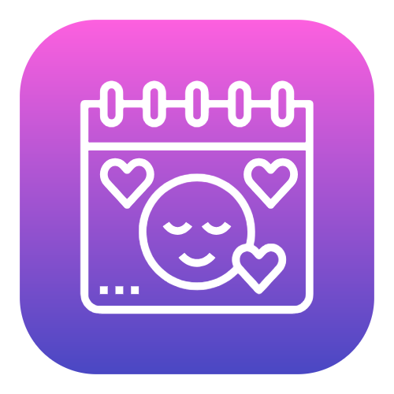

<p align="center">
  
</p>

# Life Tracker & Analytics

> **Local-first longitudinal well-being analytics and habit impact tracker powered by client-side statistical heuristics.**

[English](README.md) | [Español](README.es.md)

[](https://react.dev/)
[](https://www.typescriptlang.org/)
[](https://vitejs.dev/)
[](https://tailwindcss.com/)
[](https://dexie.org/)
[](https://vitest.dev/)
[](https://web.dev/progressive-web-apps/)
[](https://www.gnu.org/licenses/agpl-3.0)

Product page: [life-tracker.ana-catalina.com](https://life-tracker.ana-catalina.com)

---

## Project Description

**Life Tracker & Analytics** is a privacy-first, local-first progressive web application engineered to turn noisy, sparse longitudinal self-tracking data into statistically responsible, actionable personal insights.

Traditional wellness apps frequently employ misleading aggregate compliance percentages (e.g., *"80% of daily goals completed"*) or deploy opaque machine learning models that overfit small $N=1$ personal datasets. This application adopts a client-side statistical heuristics methodology centered strictly on **individual factor impact**: isolating how specific habits, medications, and sleep patterns associate with cognitive focus, mood, and next-day recovery without exposing health data to external cloud servers.

### Key Features
- **Longitudinal Trend Momentum & Baseline Normalization:** Computes rolling 7-day momentum against a 28-day personal baseline distribution ($\mu_{28d}, \sigma_{28d}$), surfacing $z$-scores and directional momentum (*Improving*, *Declining*, *Stable*).
- **Lagged Time-Series Analysis ($Lag-1$):** Evaluates temporal carryover effects by isolating strictly consecutive calendar day pairs ($t-1 \to t$) to quantify how evening habits associate with next-morning sleep quality and subsequent daytime focus.
- **Sparse Calendar & Missing Data Protocol:** Missing days in the timeline are explicitly materialized as `null` observations rather than falsely coerced to zero, preserving true variance.
- **Statistical Confidence Tiers & Effect Sizes:** Uses pooled Cohen's $d$ and Pearson correlation ($r$) paired with rigorous sample-size guardrails ($N \ge 5$ minimum, $N \ge 10$ for high confidence) to suppress premature claims.
- **Local-First Zero-Knowledge Architecture:** Powered by Dexie.js (IndexedDB wrapper) for instant offline operation and persistent local storage.
- **Bring-Your-Own-Data (BYOD) Cloud Sync:** Decentralized cross-device sync via the `remoteStorage.js` open protocol, eliminating proprietary BaaS lock-in and OAuth security compliance barriers.
- **Symmetric Bilingual Internationalization:** Full English and Spanish localization across metrics, charts, insights, and documentation.

---

## Architecture & Component Responsibilities

The application follows a modular static architecture where data analysis runs strictly client-side:

| Component / Module | Responsibility | Reference Documentation |
| :--- | :--- | :--- |
| `src/utils/heuristics/timeSeries.ts` | UTC calendar timeline alignment, gap handling, 7d/28d rolling windows, and $Lag-1$ consecutive pair matching. | [Methodology Spec](docs/analytics-methodology.md) |
| `src/utils/heuristics/statistics.ts` | Pure statistical primitives: Pearson $r$, Cohen's $d$, IQR outlier filtering, baseline $z$-score deviations, and confidence tiers. | [Methodology Spec](docs/analytics-methodology.md) |
| `src/utils/heuristics/individualImpacts.ts` | Factor-by-factor isolated group differences (with vs. without) for habits, medications, and qualitative mood tags. | [Features Guide](docs/features/analytics_engine.md) |
| `src/components/LocalInsights.tsx` | Memoized analytical dashboard rendering rolling trends, baseline comparisons, lagged impacts, and narrative summaries. | [Architecture Index](docs/README.md) |
| `src/components/AnalyticsCharts.tsx` | Interactive data visualization with Recharts: cross-metric correlation lines, custom trackers, and sleep schedule plots. | [Features Guide](docs/features/analytics_engine.md) |
| `src/utils/db.ts` & `remoteStorage.ts` | Local IndexedDB persistence via Dexie.js and decentralized BYOD cloud sync. | [Database Schema](docs/architecture/database_schema.md) |

---

## Tech Stack

- **Frontend & Runtime:** React 19, TypeScript 5.8, Node.js
- **Build System & Toolchain:** Vite 6.2, `@vitejs/plugin-react`, `vite-plugin-pwa`
- **Styling & Tokens:** Tailwind CSS v4 (`@tailwindcss/vite`)
- **Data Visualization & Icons:** Recharts 3.8, Lucide React
- **Local Database:** Dexie.js 4.4 (`dexie-react-hooks`)
- **Decentralized Cloud Sync:** remoteStorage.js 2.0 (`remotestorage-widget`)
- **Testing & Quality Assurance:** Vitest 3.0, TypeScript compiler (`tsc --noEmit`)

---

## Real Example Insights Generated by the Engine

The engine generates transparent descriptive insights rather than black-box recommendations:

### 1. Lagged Habit Impact ($Lag-1$)
> **Observed Insight:**
> *"Completing 'Evening Meditation' yesterday is associated with +0.8 points higher sleep quality the next morning."*
> - **Methodology:** Filtered $n = 14$ strictly consecutive calendar day pairs ($\Delta_{\text{days}} = 1$). Calculated mean sleep quality on mornings following meditation ($8.2/10, n=7$) versus mornings without ($7.4/10, n=7$). Pooled Cohen's $d = 0.62$.
> - **Statistical Caveat:** Surfaced with *Moderate Confidence (Limited Data)* badge due to $n < 10$ in each sub-group. Framed associatively to prevent causal assumption.

### 2. Longitudinal Momentum vs. 28-Day Baseline
> **Observed Insight:**
> *"Focus Score: 7-Day Average = 7.8 vs. 28-Day Baseline = 6.4 (Δ = +1.4, z = +1.15) — Improving Trend."*
> - **Methodology:** Calendar-indexed sliding window requiring $\ge 4$ recorded observations in the trailing 7 days and $\ge 10$ observations in the trailing 28 days. Evaluated against the user's historical standard deviation ($\sigma_{28d} = 1.22$).
> - **Statistical Caveat:** Does not evaluate against an arbitrary population norm; benchmarks exclusively against the individual's personal reference distribution.

---

## Getting Started

### Prerequisites
- Node.js $\ge 18.0.0$
- npm $\ge 9.0.0$

### Local Setup & Compilation

```bash
# 1. Clone the repository
git clone https://github.com/AnaCataVC/life-tracker-analytics.git
cd life-tracker-analytics

# 2. Install dependencies
npm install

# 3. Start local development server
npm run dev

# 4. Compile optimized production PWA bundle
npm run build

# 5. Preview production build locally
npm run preview
```

The production output will be generated inside `dist/`, including service worker scripts and cached PWA assets.

---

## Automated Testing

The repository maintains an automated deterministic test suite covering pure mathematical heuristics, missing-data semantics, calendar continuity, and BYOD synchronization helpers.

```bash
# Run the complete automated test suite
npm test

# Run strict TypeScript static type analysis
npm run lint
```

Detailed test specifications and synthetic fixtures are located in `tests/analyticsMethodology.test.ts` and `tests/heuristics.test.ts`.

---

## Key Learnings & Architectural Decisions

1. **Client-Side TypeScript Heuristics over Python/ML Microservices:**
   Personal longitudinal tracking datasets ($N \approx 30 - 365$ entries) do not warrant the infrastructure overhead, latency, and hosting costs of a Python backend or the ~30MB WebAssembly bundle size of Pyodide. Running statistical algorithms (Pearson $r$, Cohen's $d$, rolling averages, and IQR filtering) in client-side TypeScript ensures zero latency, complete offline operability, and strict zero-knowledge privacy.
2. **Sparse Time-Series Protocol & Missing Data Semantics:**
   In longitudinal tracking, a skipped day does not mean zero hours of sleep or zero mood. Missing calendar dates are treated as unobserved values (`null`) rather than coerced to zero. All rolling windows (7-day and 28-day) require minimum observation densities ($\ge 4$ and $\ge 10$ days respectively) before reporting trends.
3. **Temporal Separation: Intra-Day Rest vs. Lagged Habit Influence:**
   In daily logging, `entry.sleepDuration` naturally precedes waking `entry.concentration` on the same date. Conflating this with a naive array lag ($i-1$) would correlate sleep from 48 hours earlier with today's focus. The architecture formally separates direct intra-day sleep effects from true $Lag-1$ habit effects (evaluating activities from day $t-1$ against morning rest on day $t$ across verified consecutive calendar dates).
4. **Decentralized BYOD Cloud Architecture:**
   Rather than locking users into a proprietary Backend-as-a-Service (BaaS) or undergoing third-party OAuth security audits (e.g., Google OAuth Trust & Safety), the app adopts the `remoteStorage.js` open standard. Users connect their own independent storage provider, maintaining total sovereignty over their personal records.
5. **Associative Invariance over Unsubstantiated Causality:**
   In $N=1$ self-tracking data, confounding variables (e.g., weekends, illness, seasonal shifts) prevent causal inference. The engine strictly enforces associative phrasing in all UI copy and translations, preventing misleading claims.

---

## License

This project is licensed under the [GNU Affero General Public License v3.0 (AGPLv3)](LICENSE). Any modification or enhancement deployed as a network service or progressive web app must remain open-source under identical terms, preserving the privacy and transparency guarantees of the software.
